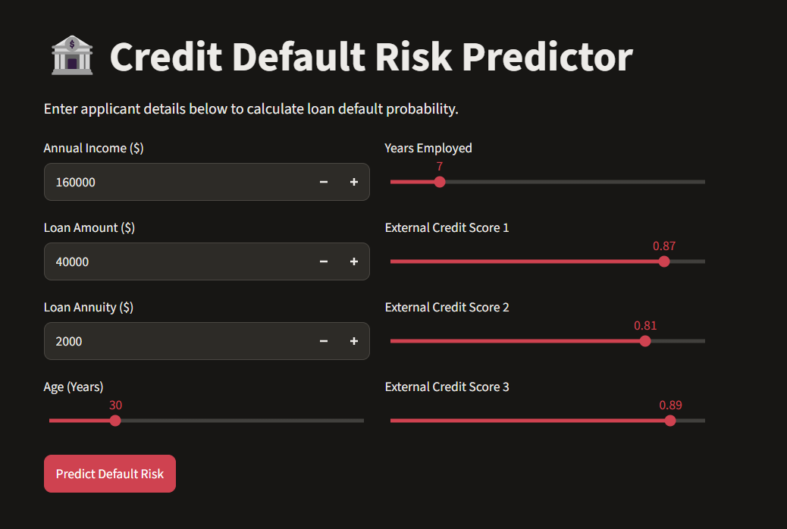
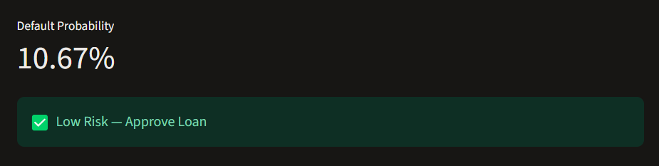

<div align="center">

# Home Credit Default Risk Predictor
[](https://www.python.org/)
[](https://streamlit.io/)
[](https://xgboost.readthedocs.io/)
[](https://scikit-learn.org/)
[](LICENSE)

</div>

## Overview

A machine learning web application that predicts consumer loan default risk in real time. 

The system uses an end-to-end Scikit-Learn preprocessing pipeline and an XGBoost Classifier trained on the Home Credit Default Risk dataset, achieving a **0.7667 validation ROC-AUC** after hyperparameter optimization.

---

## Application Interface

| Loan Details Input | Prediction & Underwriting Decision |
| :---: | :---: |
|  |  |

---

## Features

- **End-to-End Pipeline**: Combines median imputation, standard scaling, one-hot encoding, and an optimized `XGBClassifier` into a single serialized pipeline.
- **Cost-Sensitive Training**: Configured with `scale_pos_weight = 11` to handle the ~8% default class imbalance inherent in lending data.
- **Dynamic Decision Rules**:
  - 🟢 **Low Risk (< 15%)**: Automated loan approval recommendation.
  - 🟡 **Moderate Risk (15% – 35%)**: Flagged for manual underwriting review.
  - 🔴 **High Risk (> 35%)**: High default probability / recommended rejection.
- **Baseline Feature Imputation**: Supplies 126 auxiliary dataset columns from pre-calculated medians (`models/baseline_features.joblib`), keeping the input form concise.
- **Full Model Notebook**: Complete exploratory analysis, model benchmarking (Random Forest, MLP, XGBoost), and grid search documented in [`notebook/home-credit-default-risk-project.ipynb`](notebook/home-credit-default-risk-project.ipynb).

---

## Feature Rationales

The raw dataset contains over 130 attributes. The application exposes the 8 most important features (identified via SHAP and XGBoost feature importance), while maintaining the remaining attributes at baseline medians:

| Input Feature | Dataset Field | Description |
|---|---|---|
| **Annual Income ($)** | `AMT_INCOME_TOTAL` | Primary indicator of financial repayment capacity. |
| **Loan Amount ($)** | `AMT_CREDIT` | Total requested loan amount. |
| **Loan Annuity ($)** | `AMT_ANNUITY` | Periodic installment obligation; vital for Debt-to-Income (DTI) ratio. |
| **Age (Years)** | `DAYS_BIRTH` | Applicant age (stored internally as negative days). |
| **Years Employed** | `DAYS_EMPLOYED` | Proxy for employment stability. |
| **External Credit Score 1** | `EXT_SOURCE_1` | Normalized score (0.0–1.0) from external Credit Bureau 1. |
| **External Credit Score 2** | `EXT_SOURCE_2` | Normalized score (0.0–1.0) from external Credit Bureau 2. |
| **External Credit Score 3** | `EXT_SOURCE_3` | Normalized score (0.0–1.0) from external Credit Bureau 3. |

> **External Credit Scores (1, 2, 3)**: In commercial lending, risk models query multiple independent credit rating agencies (e.g., Experian, TransUnion, Equifax). Home Credit normalized these third-party scores on a continuous scale between 0.0 (high risk) and 1.0 (low risk).

---

## Quick Start

```bash
pip install -r requirements.txt
streamlit run app.py
```

---

## License

This project is licensed under the [MIT License](LICENSE).
